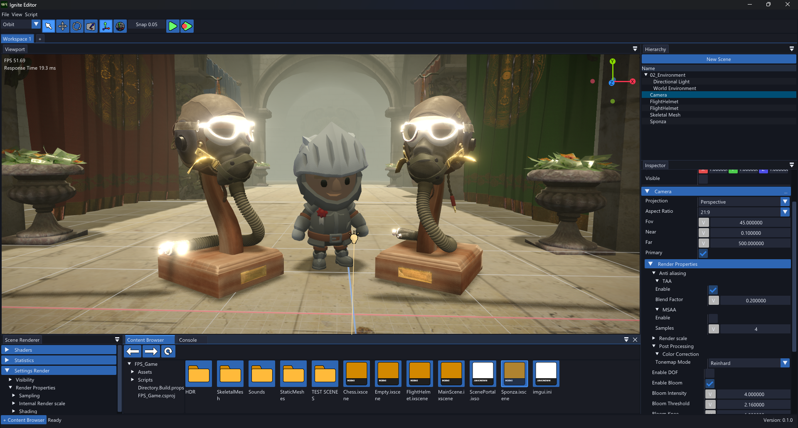
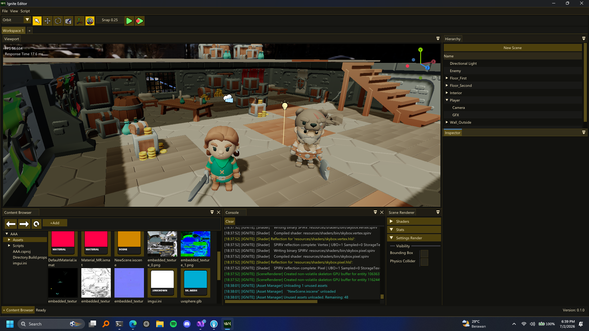
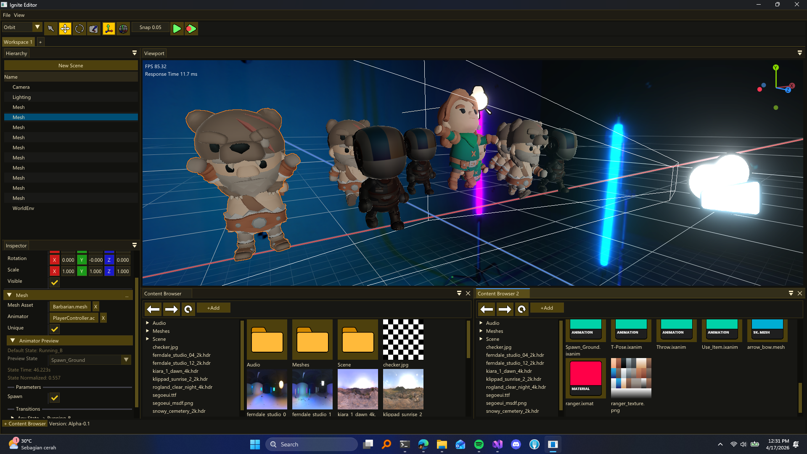
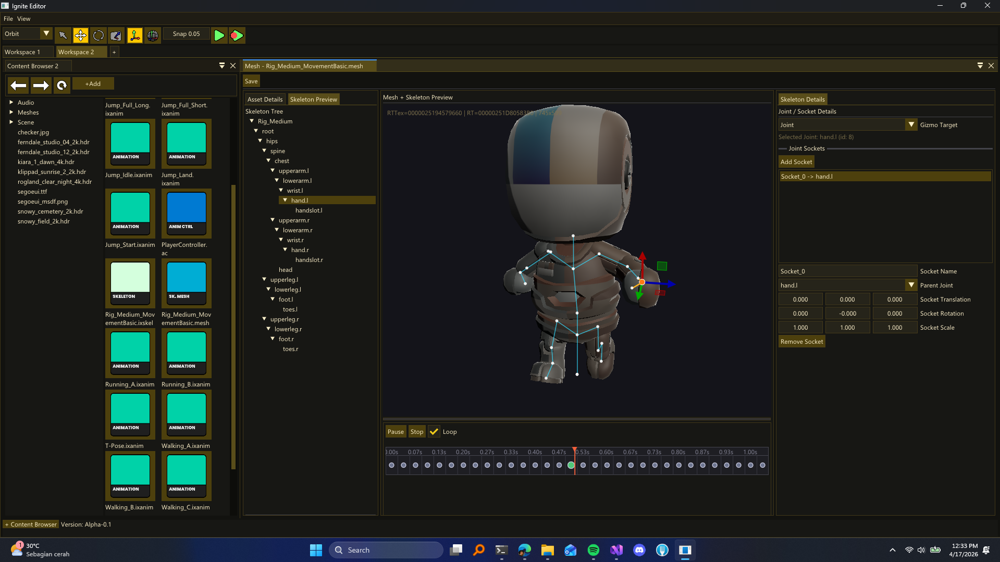
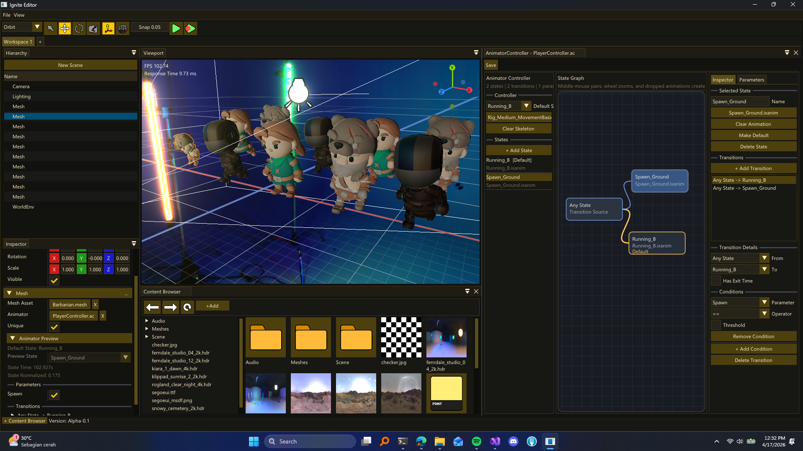
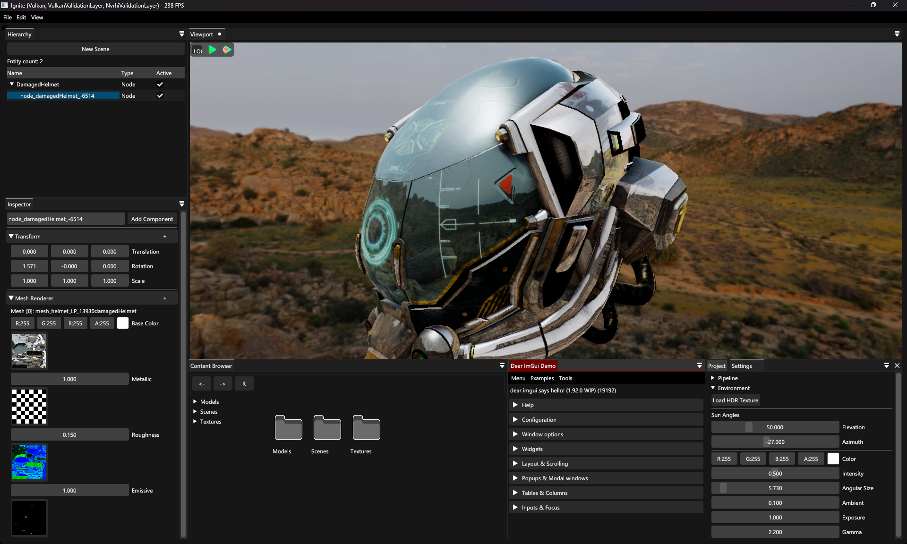

# Ignite Engine

Work in progress C++ Game Engine

[](https://github.com/evangelionxyz/IgniteEngine/actions/workflows/ci.yml)
[](https://github.com/evangelionxyz/IgniteEngine/stargazers)

## Prerequisites

- **C++ Compiler**: C++23 compliant (`MSVC v143+` / VS 2022+ on Windows, `GCC 14+` or `Clang 18+` on Linux)
- **Rust Toolchain**: `cargo` & `rustc` (stable)
- **.NET SDK**: .NET 10.0 SDK
- **Python**: Python 3.10+
- **Vulkan SDK**: Vulkan SDK 1.4+ (automatically downloaded on Linux if not present)
- **CMake**: 3.28+

## Installation

### Clone Repository Recursively

We actively develop on the `dev` branch. Clone with `--recursive` to initialize git submodules:
```bash
git clone --recursive https://github.com/evangelionxyz/IgniteEngine.git -b dev
```

## Windows Build

1. Run the bootstrap script to download dependencies, build prerequisites, and generate Visual Studio project files:
```cmd
gen.bat
```

2. Restore and Build with MSBuild (or open `IGN.slnx` in Visual Studio):
```cmd
msbuild IGN.slnx /t:Restore /p:Configuration=Debug /p:Platform=x64
msbuild IGN.slnx /t:Build /p:Configuration=Debug /p:Platform=x64
```

To build in Release configuration, replace `Debug` with `Release`.

## Linux Build (Native & WSL2)

1. Run the bootstrap script to install system packages via `apt`, configure SDKs, install .NET tooling symlinks, and generate GNU Makefiles:
```bash
chmod +x gen.sh
./gen.sh
```

2. Build the Editor:
```bash
make -j$(nproc) config=debug Ignite.Editor
```

3. Build the C# Script Engine:
```bash
make -j$(nproc) config=debug Ignite.ScriptEngine
```

4. Build and Run the Test Suite:
```bash
make -j$(nproc) config=debug Ignite.Test
./bin/Debug/Ignite.Test
```

> **Note**: For Release builds, use `config=release` (binaries are emitted to `bin/Release/`).

## Docker Build

```bash
# 1. Build the Docker image once
docker build -t ignite-image:latest .

# 2. Run container with source tree mounted
docker run -it --rm -v "${PWD}:/workspace" ignite-image:latest

# 3. Inside container: generate project files
python3 scripts/setup.py

# 4. Build C++ Editor
make -j$(nproc) config=debug Ignite.Editor

# 5. Build C# ScriptEngine
make -j$(nproc) config=debug Ignite.ScriptEngine

# 6. Build and run tests
make -j$(nproc) config=debug Ignite.Test
./bin/Debug/Ignite.Test
```

## Preview

<div style='display:flex;flex-direction:column;width:80%;margin:auto; gap:12px'>
  
  
  
  
  
  
  
</div>
