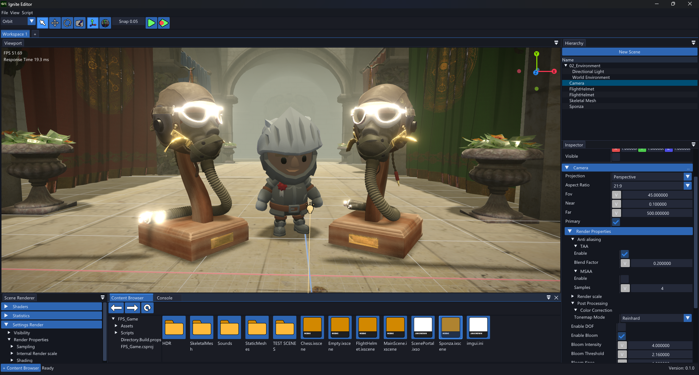
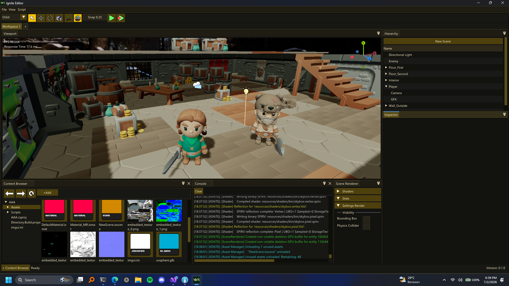
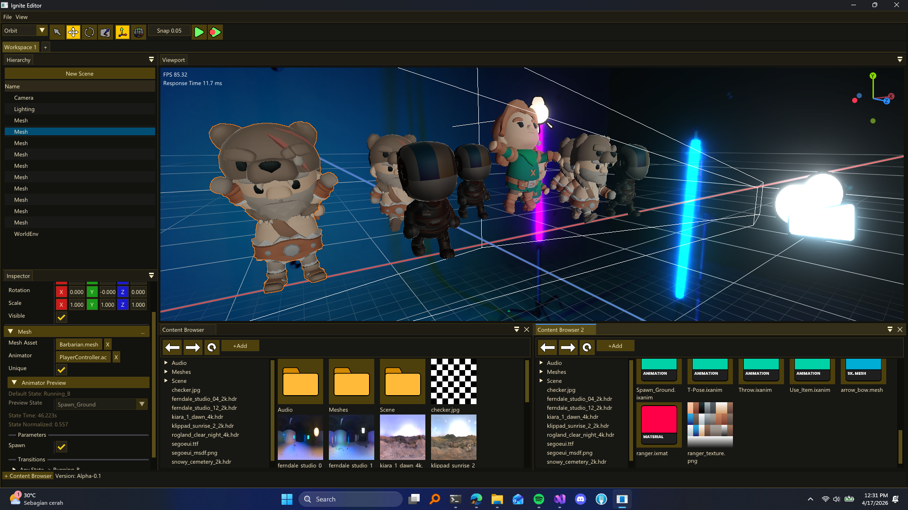
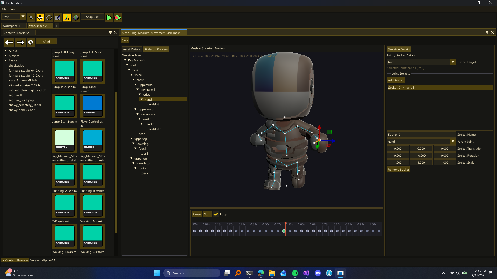
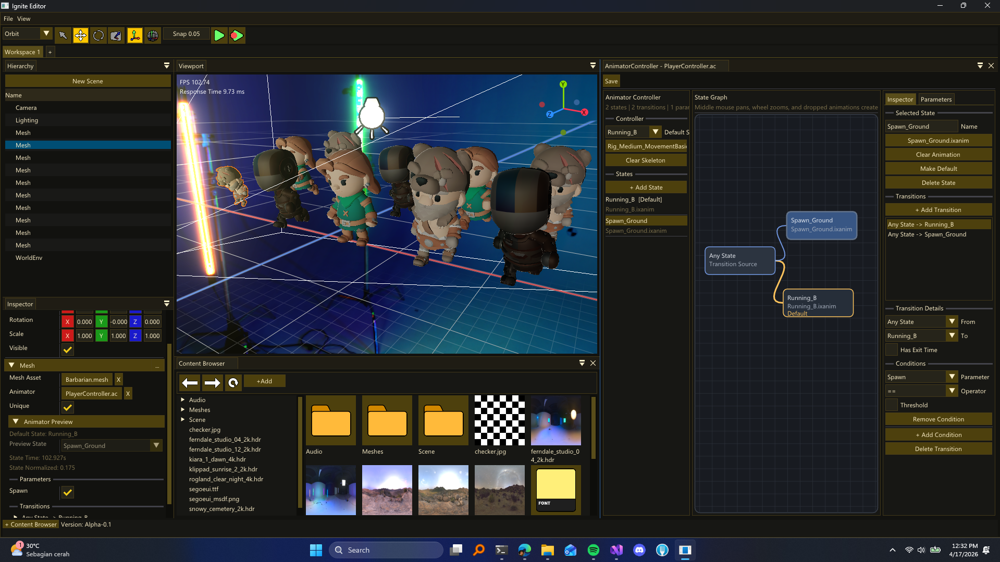
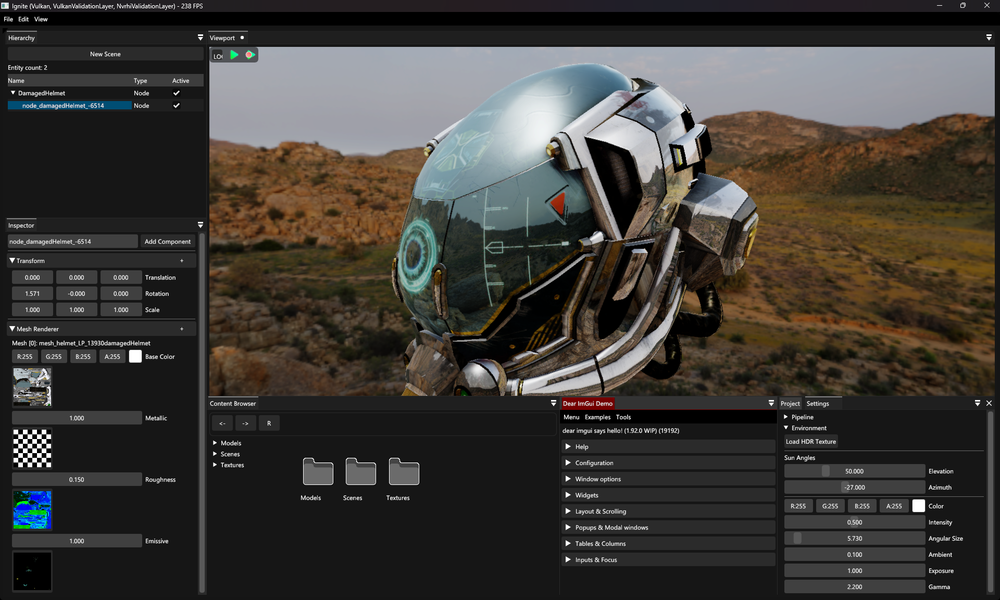
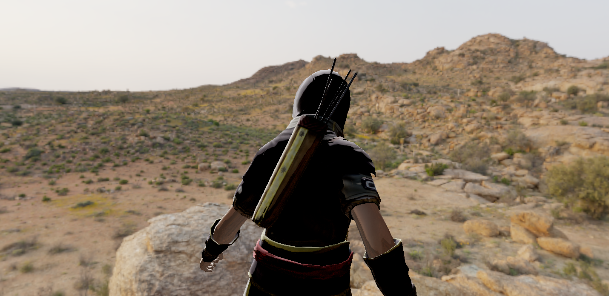

# Ignite Engine

Work in progress C++ Game Engine

[](https://github.com/evangelionxyz/IgniteEngine/actions/workflows/ci.yml)
[](https://github.com/evangelionxyz/IgniteEngine/stargazers)
[](https://hub.xerj.org/contributors/evangelionxyz)

## Prerequisites

- **C++ Compiler**: C++23 compliant (`MSVC v143+` / VS 2022+ on Windows, `GCC 14+` or `Clang 18+` on Linux)
- **Rust Toolchain**: `cargo` & `rustc` (stable)
- **.NET SDK**: .NET 10.0 SDK
- **Python**: Python 3.10+
- **Vulkan SDK**: Vulkan SDK 1.4+ (automatically downloaded on Linux if not present)
- **CMake**: 3.28+

## Installation

### Clone Repository Recursively

We actively develop on the `dev` branch. Clone with `--recursive` to initialize git submodules:
```bash
git clone --recursive https://github.com/evangelionxyz/IgniteEngine.git -b dev
```

## Windows Build

1. Run the bootstrap script to download dependencies, build prerequisites, and generate Visual Studio project files:
```cmd
gen.bat
```

2. Restore and Build with MSBuild (or open `IGN.slnx` in Visual Studio):
```cmd
msbuild IGN.slnx /t:Restore /p:Configuration=Debug /p:Platform=x64
msbuild IGN.slnx /t:Build /p:Configuration=Debug /p:Platform=x64
```

To build in Release configuration, replace `Debug` with `Release`.

## Linux Build (Native & WSL2)

1. Run the bootstrap script to install system packages via `apt`, configure SDKs, install .NET tooling symlinks, and generate GNU Makefiles:
```bash
chmod +x gen.sh
./gen.sh
```

2. Build the Editor:
```bash
make -j$(nproc) config=debug Ignite.Editor
```

3. Build the C# Script Engine:
```bash
make -j$(nproc) config=debug Ignite.ScriptEngine
```

4. Build and Run the Test Suite:
```bash
make -j$(nproc) config=debug Ignite.Test
./bin/Debug/Ignite.Test
```

> **Note**: For Release builds, use `config=release` (binaries are emitted to `bin/Release/`).

## Docker Build

```bash
# 1. Build the Docker image once
docker build -t ignite-image:latest .

# 2. Run container with source tree mounted
docker run -it --rm -v "${PWD}:/workspace" ignite-image:latest

# 3. Inside container: generate project files
python3 scripts/setup.py

# 4. Build C++ Editor
make -j$(nproc) config=debug Ignite.Editor

# 5. Build C# ScriptEngine
make -j$(nproc) config=debug Ignite.ScriptEngine

# 6. Build and run tests
make -j$(nproc) config=debug Ignite.Test
./bin/Debug/Ignite.Test
```

## Preview

<div style='display:flex;flex-direction:column;width:80%;margin:auto; gap:12px'>
  
  
  
  
  
  
  
</div>

# Engine Architecture

## 1. Rendering, Shaders & Procedural Geometry

### Shader & Lighting ([`ignite/editor/resources/shaders/`](ignite/editor/resources/shaders/))
- **Tonemapping & sRGB-to-Linear ([`include/helpers.hlsli`](ignite/editor/resources/shaders/include/helpers.hlsli), [`mesh_static.pixel.hlsl`](ignite/editor/resources/shaders/mesh_static.pixel.hlsl), [`mesh_anim.pixel.hlsl`](ignite/editor/resources/shaders/mesh_anim.pixel.hlsl))**:
  - Fixed `Reinhard2Tonemap` and `FilmicTonemap` white-scale normalization (`mappedColor *= whiteScale` instead of squaring `mappedColor`), switched `FilmicTonemap` to a linear-space Narkowicz ACES approximation, and guarded `pow(..., 1.0f / max(gamma, 0.001f))` against negative/zero inputs.
  - Applied `SRGBToLinear` to albedo and emissive texture samples in static and animated PBR pixel shaders.
- **IBL & Environment Sampling ([`include/helpers.hlsli`](ignite/editor/resources/shaders/include/helpers.hlsli), [`mesh_static.pixel.hlsl`](ignite/editor/resources/shaders/mesh_static.pixel.hlsl), [`mesh_anim.pixel.hlsl`](ignite/editor/resources/shaders/mesh_anim.pixel.hlsl))**:
  - Switched `SampleSphericalMap` and `SampleEnvironmentMap` to `SampleLevel(..., 0.0f)`, replaced the 32-tap runtime trigonometric irradiance loop with a precomputed 8-direction Fibonacci SH cosine lobe projection (`k_IrradianceDirs`), and added `SampleRoughEnvironmentSpecular` for roughness-based specular IBL blur.
- **Tangent Space, Shadows & Post-Processing**:
  - Orthonormalized vertex tangent frames with safe degenerate fallbacks in [`mesh_static.vertex.hlsl`](ignite/editor/resources/shaders/mesh_static.vertex.hlsl), [`mesh_anim.vertex.hlsl`](ignite/editor/resources/shaders/mesh_anim.vertex.hlsl), and their pixel shaders.
  - Fixed CSM slope-scaled bias sign (`dot(normal, lightDirection)`) in [`include/shadow.hlsli`](ignite/editor/resources/shaders/include/shadow.hlsli).
  - Hardened point/spot light range/attenuation denominators and skip-on-zero checks.
  - Replaced the 9x9 grid DoF loop (81 taps) in [`composite.pixel.hlsl`](ignite/editor/resources/shaders/composite.pixel.hlsl) with a 12-tap Poisson disc filter (`k_PoissonDof`) and applied SSAO/fog consistently after DoF.
  - Normalized bilateral depth weighting in [`ssao_blur.compute.hlsl`](ignite/editor/resources/shaders/ssao_blur.compute.hlsl) by `max(centerDepth * 0.05f, 0.01f)` for distance-independent edge preservation.

### `SceneRenderer`, GPU Buffers & Procedural Meshes
- **`FramePacket` Render Architecture ([`frame_packet.hpp`](ignite/engine/src/ignite/graphics/renderer/frame_packet.hpp), [`scene_renderer.cpp`](ignite/engine/src/ignite/graphics/renderer/scene_renderer.cpp))**:
  - Extracted per-frame view/projection matrices, point/spot light data (`CollectSceneLighting`), static meshes, skeletal meshes, terrain items, and parallel world-space `AABB` arrays into a reusable `FramePacket` with contiguous capacity across frames.
  - Enabled batch frustum visibility culling (`Frustum::IsAABBVisibleBatch` + reusable `visibilityScratch`) for CSM shadow passes and sorted transparent draws back-to-front by camera distance.
- **Persistent Mapped GPU Buffers & Upload Caching**:
  - Enabled persistent `nri::MapBuffer` mappings with `DEVICE_UPLOAD` -> `HOST_UPLOAD` fallback across [`FrameContext`](ignite/engine/src/ignite/graphics/frame_context.cpp) (`ObjectBuffer`, `InstanceIndexBuffer`, `BoneBuffer`), [`ConstantBuffer`](ignite/engine/src/ignite/graphics/buffers/constant_buffer.cpp), [`VertexBuffer`](ignite/engine/src/ignite/graphics/buffers/vertex_buffer.cpp), and [`IndexBuffer`](ignite/engine/src/ignite/graphics/buffers/index_buffer.cpp).
  - Added dirty comparison in [`Material::UploadToGPU`](ignite/engine/src/ignite/graphics/objects/material.cpp) to avoid redundant constant buffer uploads when material GPU data is unchanged.
- **Procedural Geometry (`MeshBuilder` & `Renderer`)**:
  - Added [`MeshBuilder`](ignite/engine/src/ignite/graphics/objects/mesh_builder.hpp) ([`mesh_builder.cpp`](ignite/engine/src/ignite/graphics/objects/mesh_builder.cpp)) supporting procedural `Cube`, `Sphere`, `Icosphere`, `Cylinder`, `Capsule`, `Plane`, `Cone`, and `Torus`, plus modifiers (`Append`, `Transform`, `RecalculateNormals`, `RecalculateTangents`, `FlipNormals`, `Subdivide`, `DisplaceAlongNormal`, `ApplyPerlinDisplacement`, `CalculateAABB`, `BuildPrimitive`, `BuildStaticMesh`).
  - Integrated deterministic default mesh handles (`Renderer::GetDefaultMesh`, `GetDefaultMeshHandle`, `IsDefaultMeshHandle`, `GetDefaultMeshByHandle`, `ParseMeshType`) in [`renderer.hpp`](ignite/engine/src/ignite/graphics/renderer.hpp) and [`renderer.cpp`](ignite/engine/src/ignite/graphics/renderer.cpp).
- **Camera, glTF, SSAO, Audio & 3D Physics**:
  - Fixed orthographic camera view orientation ([`icamera.cpp`](ignite/core/src/ignite/scene/icamera.cpp)), delta-time focus smoothing ([`editor_camera.cpp`](ignite/engine/src/ignite/scene/editor_camera.cpp)), zero/small viewport guards ([`scene_camera.cpp`](ignite/engine/src/ignite/scene/scene_camera.cpp)), and orthographic frustum bounds in [`shadow_map.cpp`](ignite/engine/src/ignite/graphics/objects/shadow_map.cpp).
  - Implemented external URI texture loading and orthonormal tangent generation when glTF omits tangents in [`mesh.cpp`](ignite/engine/src/ignite/graphics/objects/mesh.cpp).
  - Tracked texture layouts properly (`TransitionTexture` with depth/stencil `PlaneBits`) in [`ssao.cpp`](ignite/engine/src/ignite/graphics/ssao.cpp).
  - Added null channel/sound guards, corrected `IsLooped()`, and clamped fade curves in [`fmod_sound.cpp`](ignite/engine/src/ignite/audio/fmod_sound.cpp).
  - Enabled raycasts against static + moving broadphase layers with world-space surface normals and canonical sub-shape exit tracking in [`jolt_physics.hpp`](ignite/physics/src/ignite/physics/3d/jolt/jolt_physics.hpp) and [`jolt_physics.cpp`](ignite/physics/src/ignite/physics/3d/jolt/jolt_physics.cpp).

---

## 2. Lua 5.4 Scripting ([`lua.hpp`](ignite/engine/src/ignite/scripting/lua/lua.hpp), [`lua.cpp`](ignite/engine/src/ignite/scripting/lua/lua.cpp), [`lua_script_runtime.cpp`](ignite/engine/src/ignite/scripting/lua/lua_script_runtime.cpp))

- **Sandboxed Per-Instance Environments & Lifecycle**:
  - Each script component runs in its own Lua environment table (`environmentRef` inheriting globals via metatable). Note: interactive snippets run via `ExecuteSnippet` read `_G`, so variables intended for live inspection should be stored on `_G`.
  - Automatically instantiates runtime-added `LuaScriptComponent` instances during updates.
  - Passes fixed timestep (`fixedDeltaTime`, defaulting to `1.0f / 60.0f`) to `on_fixed_update(entity, fixedDt)`.
  - Dispatches Jolt 3D physics events to `on_collision_enter`, `on_collision_stay`, and `on_collision_exit` callbacks from [`scene.cpp`](ignite/engine/src/ignite/scene/scene.cpp).
  - Exposed `ScriptRuntime::ExecuteSnippet(code, outResult, outError)` for safe dynamic Lua evaluation.
- **Expanded `Ignite` Lua Bindings**:
  - Entities, components & primitives: `Ignite.FindEntity`, `FindEntityByName`, `CreateEntity`, `CreatePrimitive`, `DestroyEntity`, `DuplicateEntity`, `GetEntitiesWith`, `InstantiatePrefab`, plus `Entity:HasComponent` / `GetComponent` / `AddComponent` / `RemoveComponent`.
  - Math: `Ignite.Vec2` / `Vec3` / `Vec4` with arithmetic metamethods and `Ignite.Math` (`Lerp`, `Clamp`, `Smoothstep`, `Deg2Rad`, `Rad2Deg`, `Dot`, `Cross`, `Distance`).
  - Subsystems: `Ignite.Scene` (`Load`, `GetTime`, `IsPlaying`, `IsSimulating`, `IsPaused`, `GetPrimaryCamera`), `Ignite.Physics.Raycast`, `Ignite.Net` (`IsConnected`, `IsServerRunning`, `GetClientId`, `StartServer`, `StopServer`, `Connect`, `Disconnect`, `SendInput`, `SendChat`), and `Ignite.Input` / `Ignite.Key` / `Ignite.Mouse`.
- **C# Script Build Skip Optimization ([`script_engine.cpp`](ignite/engine/src/ignite/scripting/script_engine.cpp))**:
  - Avoids unnecessary MSBuild invocations when the compiled project script assembly (`GetScriptModulePath()`) already exists and core dependencies / `.cs` timestamps are up to date.

---

## 3. Networking & Dedicated Server ([`network_manager.cpp`](ignite/engine/src/ignite/net/network_manager.cpp), [`net_replication.cpp`](ignite/engine/src/ignite/net/net_replication.cpp), [`ignite/net/`](ignite/net/))

- Fixed Windows `<winspool.h>` macro collision (`SetPortW`) by renaming `NetworkManager::SetPort` to [`SetServerPort`](ignite/engine/src/ignite/net/network_manager.hpp).
- Drained **all** queued client input commands per server tick (rather than only `inputs.back()`), scaled non-character movement by `tickInterval`, and marked `TransformComponent::dirty = true`.
- Reconciled client prediction using configurable `m_UiTickRate` and `GetDefaultSpeed()`, while preserving and smoothly applying `m_Prediction.GetVisualOffset()` deltas onto the local player transform in [`net_replication.cpp`](ignite/engine/src/ignite/net/net_replication.cpp).
- Added bidirectional project settings sync (`SyncFromProject`, `SyncToProject`, `GetServerSettings`, `SetServerSettings`) and serialized `IsLocalPlayer` and `SyncComponentsMask` in [`entity_serializer.cpp`](ignite/engine/src/ignite/serializer/entity_serializer.cpp).
- Updated [`ignite/net/ignite.net.lua`](ignite/net/ignite.net.lua) (JSON include path) and [`ServerApp`](ignite/net/src/ignite/app.cpp) to support headless server execution with CLI flags `--port`, `--project`, `--scene`, `--tickrate`, and `--snapshotrate`.

---

## 4. Standalone Runtime & Game Packaging ([`game_packager.cpp`](ignite/engine/src/ignite/project/game_packager.cpp), [`runtime_layer.cpp`](ignite/runtime/src/runtime_layer.cpp))

- **Game Packaging (`GamePackager::PackageProject`)**:
  - Available via Editor menu **`File -> Package Game...`** ([`editor_layer.cpp`](ignite/editor/src/editor_layer.cpp)) or headless/live agent command `package_game`.
  - Exports a self-contained distribution directory containing renamed client (`<Game>.exe`) and optional dedicated server (`<Game>_Server.exe`) binaries, runtime DLL/`.deps.json`/`.runtimeconfig.json` dependencies (and `runtimes/` when present), compiled C# scripts (`Bin/` without requiring `.slnx` on target machines), project `.ixproj`, asset registry (`AssetRegistry.ixreg`), project assets & scripts directories, and engine `resources/`.
  - Sanitizes project names containing spaces/punctuation into valid C# identifiers via `SanitizeCSharpIdentifier` in [`project.cpp`](ignite/engine/src/ignite/project/project.cpp), and switches C# script solution builds to `dotnet msbuild ... /restore` with standalone `msbuild` fallback.
- **Standalone Runtime (`Ignite.Runtime.exe`) & Headless Safety**:
  - Updated [`RuntimeApp`](ignite/runtime/src/runtime_app.cpp), [`RuntimeLayer`](ignite/runtime/src/runtime_layer.cpp), and [`Application`](ignite/engine/src/ignite/core/application.cpp) with a 60 Hz fixed-timestep accumulator, `.ixproj` auto-discovery in the working or executable directory, automatic working-directory alignment when `resources/` sits next to the executable, and CLI flags:
    - `--project <path>`, `--scene <path>`, `--connect <ip:port>`
    - `--windowed`, `--offscreen`, `--headless`, `--nogui`, `--hide-overlay`
  - Fixed `--nogui` / `--headless` crash in both [`editor_layer.cpp`](ignite/editor/src/editor_layer.cpp) and [`runtime_layer.cpp`](ignite/runtime/src/runtime_layer.cpp) by returning `bool` from `BindSharedImGuiContext()` and returning `false` early when `!app->GetCreateInfo().useGui`.

---

## 5. AI Automation (`AgentExecutionContext`) & MCP Server

- **Engine Control Plane ([`agent_controller.hpp`](ignite/engine/src/ignite/core/agent_controller.hpp), [`agent_controller.cpp`](ignite/engine/src/ignite/core/agent_controller.cpp))**:
  - Supports batch execution (`--command-script <file>`, `--command-report <file>`, `--quit-after-script`) and live per-frame file IPC (`--watch-command-file <cmd.json>`, `--response-file <res.json>`).
  - `AgentController::IsAutomationActive()` keeps [`Application::Run`](ignite/engine/src/ignite/core/application.cpp) ticking and rendering even when unfocused or minimized.
  - Gated `EditorLayer`'s `AgentController::Get().Update` behind `if (!m_State.isLoading)` and moved `m_ActiveProject` / `m_CurrentProjectFilepath` assignment onto the main thread in `OpenProject` ([`editor_layer.cpp`](ignite/editor/src/editor_layer.cpp)), ensuring `ping` / automation commands wait until asynchronous `AssetWorker` project + scene loading finishes.
  - Supported JSON commands include:
    - **Lifecycle/Timing**: `ping`, `get_status`, `play`, `simulate`, `stop`, `pause`, `resume`, `step_frames`, `wait_frames`, `wait_seconds`, `quit`
    - **Scene/Assets/Packaging**: `load_scene`, `save_scene`, `list_assets`, `package_game`
    - **Entities/Components**: `list_entities`, `get_entity`, `create_entity` (`primitive`: `"Cube"`, `"Sphere"`, `"Icosphere"`, `"Cylinder"`, `"Capsule"`, `"Plane"`, `"Cone"`, `"Torus"`), `duplicate_entity`, `destroy_entity`, `rename_entity`, `add_component` / `set_component` / `update_component`, `remove_component`
    - **Camera/Rendering/Screenshot**: `set_camera`, `set_render_settings` (`ssao`, `bloom`, `fxaa`, `tonemap_mode`: `"uncharted2"` / `"filmic"` / `"reinhard"`, etc.), `capture_screenshot`
    - **Scripting/Physics/Networking**: `run_lua`, `physics_raycast`, `net_start_server`, `net_stop_server`, `net_connect`, `net_disconnect`, `net_send_input`, `net_send_chat`
- **MCP Server & Agent Documentation**:
  - Added pure-stdlib stdio JSON-RPC 2.0 MCP server [`scripts/ignite_mcp_server.py`](scripts/ignite_mcp_server.py) exposing 10 tools: `ignite_build_solution`, `ignite_sync_shaders`, `ignite_run_tests`, `ignite_launch_app`, `ignite_send_command`, `ignite_stop_app`, `ignite_run_command_script`, `ignite_package_game`, `ignite_start_server`, and `ignite_list_sessions`.
  - Added developer and workflow guides in [`AGENTS.md`](AGENTS.md) and [`.agents/skills/`](.agents/skills/ignite-agent-control/SKILL.md) (`ignite-build-test`, `ignite-agent-control`, `ignite-game-authoring`).

---

## 6. Verification Results

- **Full GoogleTest Suite (`bin/Debug/Ignite.Test.exe --gtest_color=no`, executed after the final C++ edit)**:
  - **132 / 132 tests passed across 27 suites** (`38795 ms`, exit code `0`, 0 failures, 0 skipped), including new test suites:
    - [`test_mesh_and_renderer.cpp`](ignite/test/src/test_mesh_and_renderer.cpp) (4 tests)
    - [`test_lua_enhancements.cpp`](ignite/test/src/test_lua_enhancements.cpp) (3 tests)
    - [`test_networking_upgrades.cpp`](ignite/test/src/test_networking_upgrades.cpp) (3 tests)
    - [`test_agent_and_packager.cpp`](ignite/test/src/test_agent_and_packager.cpp) (2 tests)
- **MCP Self-Test (`python scripts/ignite_mcp_server.py --self-test`)**:
  - Exited `0` with `"ok": true` and all 10 tools registered.
- **End-to-End Automation & `cua-driver` Verification** *(completed after all C++ edits, prior to the final `SKILL.md` doc example edit)*:
  - Controlled `Ignite.Editor.exe` over live watch IPC via `IgniteMcpServer`: waited for async project load, built a 3D physics + PBR lighting + Lua scene (`Floor`, `FallingCube`, `LuaOrb` running `bounce.lua`, `ShowcaseTorus`, `SunLight`, `AccentLight`, `MainCam`), enabled SSAO/bloom/FXAA/Uncharted2, saved `.ixscene`, entered Play mode, observed gravity fall (`y = 1.249999`), Lua 60 Hz execution (`true:63`), and `physics_raycast` hit on `Floor`, captured viewport PNG, and cleanly stopped (`returncode: 0`).
  - Packaged standalone `ShowcaseGame.exe` and `ShowcaseGame_Server.exe` via headless `Ignite.Runtime.exe` (`--offscreen --nogui --headless`, `returncode: 0`), launched `ShowcaseGame.exe --windowed --hide-overlay` via `cua-driver` (`"Ignite Runtime"`, `1080x670`) to visually confirm rendered 3D primitives and lighting without ImGui overlay, and smoke-tested `ShowcaseGame_Server.exe --port 18192` (`ALIVE_1.5S: True`, `[Jolt Physics] Physics Initialized`). Temporary E2E project artifacts (`D:\Temp\IgniteE2E`) were removed after verification.
